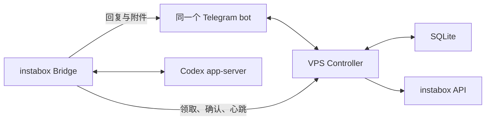

# instabox-codex-tg_bot

一个 Telegram bot，同时提供 Codex 对话、唤醒、自定义保活和休眠。

VPS Controller 持续接收 Telegram 消息，处理机器操作，将对话保存到 SQLite。instabox 内的 Bridge 恢复后主动领取消息，保留原有会话、任务队列、图片与文件、审批和标准表单。



| 命令 | 功能 |
| --- | --- |
| `/resume` | 唤醒，冷却期间等待后重试 |
| `/hold 30m`、`/hold 2h`、`/hold 8h` | 唤醒并自定义保活，最多八小时 |
| `/release` | 停止续租，允许平台按空闲规则休眠 |
| `/sleep` | 明确暂停，保留内存与进程 |
| `/vmstatus` | 查看机器、Bridge、保活和冷却 |
| `/mode manual`、`/mode auto` | 手动保活，或按交互和任务保活 |

VPS 支持 Python 3.11+ 普通用户运行，无需 root、Docker 或 systemd。在受限容器内把仓库放在 `/home/container`，然后配置：

```bash
git clone https://github.com/zv201413/instabox-codex-tg_bot.git
cd instabox-codex-tg_bot
python3 tools/configure_vps.py --mode process --port 18080
```

端口可自选，网关地址必须能由 instabox 访问；公网使用 HTTPS，私有网络可用私有 IP 的 HTTP。配置工具默认单 bot、手动保活、最长 480 分钟，凭据与 SQLite 存在持久目录。

切换顺序：**停旧 Bridge 的 TG 轮询 → 启动 VPS Controller → 启动网关模式 Bridge**。同一个 bot 只能有一个 `getUpdates` 接收端。

接入现有 `start-all.sh` 时，在环境初始化后、最终 `exec/exit` 前放入 `# INSTABOX_CONTROLLER_START`，安装器按该标记插入。监督器正常停服或因 Python 异常退出时会清理 Controller 子进程。

详见[安装、启动脚本与回退](docs/SINGLE-BOT-SETUP.md)、[Bridge 对接](docs/BRIDGE-INTEGRATION.md)、[验证范围](docs/VALIDATION.md)。Docker 部署和[旧保活工具](docs/LEGACY-KEEPALIVE.md)仍可选。

保活不延长平台运行上限，也不重置已运行时间。手动暂停后需 `/resume` 或 `/hold` 唤醒。真实 VPS 与 TG 的休眠、唤醒需部署后验收。

基于 [pingmike2/instabox-keepalive](https://github.com/pingmike2/instabox-keepalive) 扩展，遵循 [MIT License](LICENSE)。
