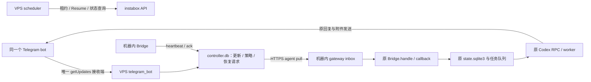

# 现有 Codex Bridge 与 VPS Controller 对接

当前公开仓库发布 VPS Controller 和通用 agent 接口。完整 `bridge/codex/` 只在本地保留，不随 GitHub 仓库分发；它仍是机器内实际承载 Codex 对话、文件、审批和表单的程序。本页说明两者如何接起来，不要求把完整 Bridge 上传。

## 1. 两端结构与职责



| 位置 | 文件 / 入口 | 对接职责 |
| --- | --- | --- |
| VPS | `controller/main.py` | 启动 TG 接收、策略调度、agent HTTP 服务和健康监督 |
| VPS | `controller/telegram_bot.py` | 接收并保存 TG 更新；处理机器命令；其余对话转交 Bridge |
| VPS | `controller/scheduler.py` | 固定机器的恢复、冷却、短租约和用户策略；不运行 Codex |
| VPS | `controller/agent_api.py` | 带独立鉴权及机器/agent 绑定的 pull、ack、heartbeat |
| 公开通用适配器 | `bridge/gateway_client.py`、`bridge/inbox.py` | HTTP 客户端、持久 inbox、通用交互有效性辅助函数 |
| 本地配套 Bridge | `bridge/codex/bridge.py` | 选择消息来源；新 transport 接回原 `handle()`、`callback()` 和任务队列 |
| 本地配套 Bridge | `bridge/codex/gateway.py` | 可随现有 Bridge 独立安装的客户端与 inbox；避免运行目录依赖整套 Controller |
| 原 Bridge 业务 | `elicitation.py`、原 Store/RPC/worker、原 TG 发送客户端 | 保留会话、账号、附件和审批/表单；网关不替代这些功能 |

VPS 不需要模型提供方 key，不替用户审批，不接管 Codex 状态库。机器内 Bridge 主动出站访问 VPS；不需要向 instabox 开新的入站端口。

## 2. 现有目录如何安装

本机待部署的完整源码位于 `bridge/codex/`；原 instabox 运行目录通常为 `/data/home/telegram-codex/`：

```text
/data/home/telegram-codex/
├── bridge.py                  原 Bridge，新增 gateway 接收入口
├── elicitation.py             原标准表单逻辑
├── gateway.py                 自包含 transport 与本地 inbox
├── secrets.json               原配置，合并网关字段；不上传
├── state.sqlite3              原账号、会话、任务和结果；保留
└── gateway-inbox.sqlite3       新增消息交付库，首次运行创建
```

部署配套接入版时更新 `bridge.py`、`elicitation.py`、`gateway.py`，保留原配置、状态库和 Codex 会话。不要把空示例配置覆盖原配置，不重新绑定已有用户，不把两个状态库合并成一个。

公开 `bridge/gateway_client.py` 导入 `controller.config`，适合以完整仓库包结构使用。原程序自身叫 `bridge.py`，直接在旁边写 `from bridge.gateway_client import ...` 还可能与模块名冲突。因此现有配套 Bridge 使用同目录的自包含 `gateway.py`，不是只复制公开客户端一个文件就能启动。

如果只持有公开仓库，需按第 4 节把 agent 协议接进自己的 Bridge，或者先使用 `control_only` 独立控制 bot。公开客户端本身不是完整 Codex bot。

## 3. 配置对应关系

同 bot 接入时，VPS 将示例中的 `TELEGRAM_GATEWAY_MODE` 改为 `gateway`。原 Bridge 的 `secrets.json` 保留已有字段，合并：

```json
{
  "message_source": "gateway",
  "gateway": {
    "url": "https://gateway.example.com",
    "secret": "YOUR_RANDOM_SECRET_AT_LEAST_32_CHARACTERS",
    "machine_id": "YOUR_MACHINE_ID",
    "agent_id": "codex-bridge"
  }
}
```

| VPS 配置 | Bridge 配置 | 要求 |
| --- | --- | --- |
| `TELEGRAM_BOT_TOKEN` | 原 `telegram_token` | 同 bot 模式必须相同；仅 VPS 轮询，Bridge 可继续发送 |
| `TELEGRAM_ALLOWED_USERS` | 原已绑定 owner 的用户 ID | VPS 白名单需包含该用户；Bridge 仍检查原私聊和绑定账号 |
| `INSTABOX_MACHINE_ID` | `gateway.machine_id` | 同一个实际承载 Bridge 的固定机器 |
| `AGENT_API_SECRET` | `gateway.secret` | 一致的独立随机密钥，不能拿 bot token 或模型 key 代替 |
| `AGENT_ID` | `gateway.agent_id` | 一致，默认 `codex-bridge` |
| HTTPS / 私有网络入口 | `gateway.url` | Bridge 实际能访问的地址，不能误填 VPS 自身 localhost |

保活时区和计划放 VPS，模型与 Codex 环境仍留机器内。原 TG token 还用于 Bridge 下载 file_id 对应附件及发送回复，不因改成 gateway 就删除。

## 4. 接到原 Bridge 的哪个入口

本地配套接入版提供以下方法；其他 Bridge 可以按相同职责对接：

| 原结构 / 方法 | 如何接入 |
| --- | --- |
| 初始化 `Bridge.__init__` | 根据 `message_source` 创建 gateway client 和本地 inbox；保留原 Telegram 发送客户端、Store 和 RPC |
| 启动 `Bridge.run` | telegram 模式启动原 `poll()`；gateway 模式启动 `gateway_poll()`，另启动独立 heartbeat 和 dispatch 任务 |
| 原 `poll()` | gateway 模式不启动，避免同 bot 两个 `getUpdates` 接收者 |
| 新 `gateway_poll()` | 出站 pull，保存原始更新和本地交互上下文，提交 inbox 后 ack VPS |
| 新 `gateway_heartbeat()` | 报告 Codex ready/busy、当前 task ID、普通队列剩余容量 |
| 新 `gateway_dispatch()` | 校验过期交互，调用原 `handle(update)`；成功交给原处理入口后 complete 本地行 |
| 原 `handle()` / `callback()` | 继续处理任务、文件、原命令、审批和表单；不把长 Codex 执行放到领取循环里 |
| 原 `worker()` / `events()` | 继续启动并处理原持久任务队列、RPC 和结果交付 |

三个循环分开运行：领取循环即使网络慢，仍不能阻塞审批处理；长任务不能阻塞心跳；普通队列满时，控制更新继续领取。

### Agent HTTP 协议

请求头使用 `Content-Type: application/json` 和 `X-Agent-Secret`（也支持 Bearer）。每个 agent 请求体都携带固定 `machine_id` 和 `agent_id`：

| 接口 | 额外请求字段 | 响应 / 语义 |
| --- | --- | --- |
| `POST /agent/heartbeat` | `version`、`codex_status`、`current_task`、`inbox_capacity` | `{"ok": true}`；只记录状态，由调度器决定是否保活 |
| `POST /agent/pull` | `limit`、`control_limit` | `{"ok": true, "ready": true, "updates": [...]}`；未就绪可返回空 updates 和 ready=false |
| `POST /agent/ack` | `update_ids` 整数列表 | `{"ok": true, "acked": N}`；确认本地已经可靠保存的更新 |
| `GET /healthz` | 无需 agent 身份 | 控制器健康，与机器是否休眠分开；不表示 Codex 已就绪 |

heartbeat 示例：

```json
{
  "machine_id": "YOUR_MACHINE_ID",
  "agent_id": "codex-bridge",
  "version": "YOUR_BRIDGE_VERSION",
  "codex_status": "ready",
  "current_task": null,
  "inbox_capacity": 20
}
```

`codex_status` 支持 `starting`、`ready`、`busy`、`offline`；current_task 为字符串或 null，容量 0–100。不要仅因为进程存在就报告 ready，需确认原 Codex 会话处理入口可工作。

先启动原 RPC，再发送 ready/busy 心跳，然后 pull。当前默认心跳有效期 90 秒，配套 Bridge 每 20 秒发送。没有新鲜心跳，Controller 不把机器 running 等同于 Bridge 就绪，pull 可能为空。

普通队列容量按原 Store 剩余槽位计算，配套 Bridge 为 `max(0, 20 - queued)`；control_limit 独立设置，例如 20。普通 limit 为 0 时审批和命令仍能进入控制通道。

### 顺序必须是 pull → 本地提交 → ack → 原业务处理

```text
VPS 保存 TG 整批更新和游标
    ↓
Bridge pull 获得完整原始 update
    ↓
本地 inbox.ingest(updates, 当前交互上下文) 提交 SQLite
    ↓
Bridge ack(update_ids) 通知 VPS
    ↓
dispatch 校验账号和交互目标
    ↓
原 handle / callback；普通任务按 update_id 加入原持久队列
    ↓
本地 inbox.complete(update_id)
    ↓
原 worker 执行 Codex；结果继续走原 TG 发送通道
```

pull 网络失败不要 ack；本地写入失败不要 ack；ack 失败允许 VPS 重投，本地按 update_id 去重。原处理失败保留本地未完成行，重试处理。complete 表示更新已交给原持久业务队列或已按规则处理，不表示整个 Codex 任务完成。

同步客户端放在网络工作线程里调用（例如 `asyncio.to_thread`）；原 Store 和 Bridge 业务仍在自己的事件循环处理。不得把原事件循环创建的 SQLite 连接带到任意网络线程使用。

## 5. 消息与校验归属

| 更新 | Controller | 原 Bridge |
| --- | --- | --- |
| `/resume`、`/hold`、`/release`、`/mode`、`/schedule`、`/vmstatus` | 处理机器策略 | 不作为新 Codex 任务 |
| 普通文字、图片、文档 | gateway 模式保存并按需唤醒 | 原 `handle()` 下载附件、入原任务队列 |
| `/status`、`/new`、`/retry`、`/file` 等原命令 | 转交 | 保留原命令逻辑 |
| `/cancel`、`/steer` | 控制通道转交 | 检查消息原始时间和当前任务身份，拒绝目标已改变的指令 |
| `gw:` 控制按钮 | 执行机器命令 | 不处理 |
| 原审批 / 标准表单 callback | 持久保存，及时确认“已收到” | 验证原用户、私聊、消息 ID、prompt token、选项；具体决定仍由 Bridge 作出 |

附件保留完整 update、caption、file_id，恢复后由原 Telegram 客户端下载；不要在 VPS 下载后重新构造一个丢失消息 ID 的更新。

领取时保存的上下文至少包括 `task_id`、`task_started_at`、`prompt_token`、`prompt_message_id`、`prompt_created_at`。dispatch 前再取当前上下文：

- 文本回答对应的问题 token 已改变或结束：提示失效，不能变成新问题的答案或新任务。
- 文本回复消息 ID 不对应当前问题：拒绝；还要核验原 TG `date`，不能用到达 VPS/Bridge 的时间替代。
- cancel/steer 的任务 ID 已改变或原时间早于该任务：拒绝。
- callback 使用原 Bridge 的真实 prompts 状态和 token 格式；按 update_id 防止重复多选回调再次切换选项。

公开 `interaction_is_current` / `GatewayReceiver` 是通用辅助，不会自动适配每个 Bridge 的表单状态。已有 Bridge 的 callback 应继续使用自身的真实 prompt 校验，不能无差别套用一个缺失当前审批上下文的默认检查。

VPS 已确认 callback 收到，Bridge 不应重复将确认当作审批结果；失效按钮通过普通回复提示。网络不确定结果仍可能产生重复提示，不承诺所有外部副作用严格一次。

## 6. 同 bot 切换步骤与回退

1. 选择无重要在途任务、审批和表单的窗口；停止原 Bridge，备份原代码、配置、状态库及 Codex 会话。
2. VPS 配置 gateway，固定正确机器、共享密钥及原 owner 白名单；准备 HTTPS 或私有网络入口。
3. 更新机器内配套 Bridge 与 gateway 模块，合并网关字段；保留原 token、账号绑定和状态库。
4. 确认同 bot 的旧 getUpdates / webhook 接收者已经停止。Controller 遇到现有 webhook 或轮询冲突会失败退出，不自行删除它们。
5. 启动 VPS Controller，再启动机器内原服务；从 `/vmstatus` 确认运行与 agent 就绪。
6. 核对并停止旧 watch/cron/Worker 续租者，再按确认的租约归属释放旧租约。
7. 验证普通消息、原命令、附件、审批、标准表单，以及暂停后消息保存与恢复交付。

机器内通常仍使用原服务：

```bash
systemctl --user stop telegram-codex
# 备份、更新配套模块并合并配置
systemctl --user start telegram-codex
journalctl --user -u telegram-codex -n 50 --no-pager
```

回退前检查并排空 VPS 和本地 gateway inbox。先停 VPS 的 TG 接收，再停 Bridge，将 `message_source` 改回 `telegram` 后启动原服务。VPS 已确认的更新不会重新出现在原 TG 轮询中，有未交付内容时应先恢复网关交付；保留两端数据卷。

## 7. 验收与排查

| 现象 | 先检查 |
| --- | --- |
| 401 | agent 密钥是否一致，是否带请求头 |
| 403 | machine_id / agent_id 是否与 VPS 固定配置一致 |
| 机器 running，但 pull 一直空 | RPC 是否可工作、heartbeat 是否 ready/busy 且新鲜、普通容量是否为 0 |
| VPS 报另一处 TG 接收者 / webhook | 是否真正停掉原 poll、其他实例和旧 webhook |
| 普通消息恢复手动暂停失败 | 这是保护行为；使用显式 `/resume` |
| 队列满时审批不通 | control_limit 是否非零、dispatch 是否独立、原 handler 是否被长任务阻塞 |
| 租约释放后仍在线 | 旧 watch/cron、其他租约、连接或任务是否仍活动 |

验收应包含机器自动暂停后发文字/附件、冷却期间保存、重复按钮、过期表单、旧答案及旧任务控制，确认会话保留且没有两处轮询。当前公开包的模拟测试只覆盖 Controller 和通用接口；本地完整配套 Bridge 已有接入回归，但真实云端对接仍需另行部署验收。
