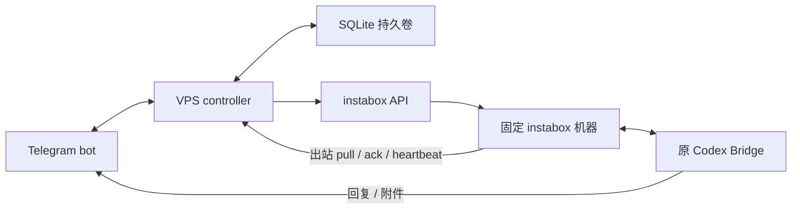

# VPS 容器：自定义保活＋TG 唤醒

VPS 常驻控制器统一接收 Telegram 更新、调度固定机器的活动租约和 Resume。当前公开包包含 Controller 和通用 agent 客户端，完整的 `bridge/codex/` 暂不发布；可先使用独立控制 bot。同 bot 对话交付需另外部署已完成网关接入的 Bridge。当前完成本地模拟回归；真实账号权限、Docker 镜像运行、云端切换及真实休眠唤醒仍需按下文验收。

活动租约不会延长平台 `maxRunMinutes`。停止本服务续租也不能保证机器休眠，其他连接、任务或租约可能继续保持活动。免费计划运行上限通常为 480 分钟；冷却以平台 `cooldownUntil`、`Retry-After` 和 `retryAfterSeconds` 为准。本服务等待冷却，不尝试绕过限制。

## 1. 架构与消息交付



`TELEGRAM_GATEWAY_MODE=gateway` 使用同一个对话 bot，VPS 是唯一 `getUpdates` 接收端。Bridge 设置 `message_source=gateway` 后从 VPS 领取更新，保留原账号绑定、会话、附件下载与发送、审批和标准表单。原 `/status` 等命令由 Bridge 处理，机器状态使用 `/vmstatus`。

`control_only` 使用独立的控制 bot，只处理机器命令；原对话 bot 和 Bridge 的 `message_source=telegram` 保持原接收方式。两个 bot 必须不同；控制器不会保存或转发控制 bot 上的普通对话。

整批 TG 更新及游标先在 VPS SQLite 提交，再请求下一批。控制命令、策略、去重和回复在同一事务提交。API 请求、TG 回复和回调确认各自异步运行；按钮确认只表示收到，不代表审批已获同意。

未 ack 的消息会重投。Bridge 先提交完整更新到本地 `gateway-inbox.sqlite3`，再 ack VPS；重复更新按 `update_id` 去重。普通队列达到 20 条时暂停领取普通消息，审批和任务控制仍可领取。Bridge 使用原审批 token、消息 ID、TG 原始时间和任务身份拒绝失效交互。

交付采用至少一次传输；回复在网络超时但 TG 实际接受时仍可能重复。消息落盘保证重启后可取回，不等于所有外部副作用都有严格一次执行保证。

## 2. 策略与命令

| 模式 | 行为 |
| --- | --- |
| `manual` | 仅显式 `/hold` 保活；普通消息、任务心跳不新建保活窗口；显式唤醒仍可用 |
| `on_demand`（默认） | 合法对话交互延长保活，近期就绪且正在执行任务的心跳可按上限续租；普通消息仅自动恢复确定为自动暂停的机器 |
| `scheduled` | 按明确时区、星期和时段续租；时段外结束本服务续租；主动唤醒默认关闭，即使开启也尊重手动暂停 |

默认租约名 `tg-controller`、TTL 300 秒、续租间隔 120 秒，交互窗口 60 分钟，连续按需保活上限 360 分钟。保活期限与短租约 TTL 分别计算；达到本服务上限后只停止续租，不中断任务。定时保活按配置时段执行，仍受平台运行上限约束。

| 命令 / 按钮 | 行为 |
| --- | --- |
| `/resume` / 唤醒 | 持久化显式恢复请求；重复请求合并，重试复用幂等键；运行和新鲜 Bridge/Codex 心跳均确认后通知就绪 |
| `/hold 60m`、`/hold 2h` / 保活 1 小时 | 显式保活；机器暂停时先保存时长并恢复，确认运行后开始计时 |
| `/release` / 结束保活 | 切换 manual、清除保活与待恢复策略，并释放自己的租约；在途续租完成后再处理释放，不直接暂停机器 |
| `/mode auto`、`/mode manual`、`/mode scheduled` | 查看或切换保活策略；切换不会自动清除现有显式窗口，彻底结束使用 `/release` |
| `/vmstatus` / 机器状态 | 查看机器、agent 就绪、保活、释放请求、恢复阶段、冷却和重试状态 |
| `/schedule` / 保活设置 | 查看设置 |
| `/schedule Asia/Shanghai 09:00-18:00 0,1,2,3,4 wake=0` | 保存计划，星期 0=周一、6=周日；支持跨午夜；`wake=1` 明确允许在时段开始恢复自动暂停机器 |
| `/schedule on`、`/schedule off` | 明确启用计划或切换 manual；结束现有显式保活使用 `/release` |

Start 默认关闭，只有明确开启 `INSTABOX_AUTO_START=1` 且显式请求目标为 Stopped 时才可调用。Resume 失败不会转 Start。401/403 阻止自动重试，修正权限后需显式 `/resume` 重试。

SQLite 保存策略、租约期限、恢复请求/幂等键/操作 ID、冷却期限、消息、回复与 TG 游标。重启恢复已有状态；环境模式和计划只初始化新库，不覆盖已保存的用户设置。已过期窗口不会重开；不要复用其他机器或租约名的数据卷。

## 3. VPS Docker 部署

先确定承载 Bridge 的机器 ID、TG 账号、VPS 入口及 HTTPS 域名或私有网络。VPS 的 instabox 凭据需具备机器读取、租约写入/释放、Resume 和操作查询权限；按平台支持的范围限制权限。模型凭据留在 instabox。instabox Secrets 出站代理占位符不能直接复制到 VPS。

从仓库根目录执行：

```bash
cp docker/.env.controller.example docker/.env.controller
chmod 600 docker/.env.controller
```

用编辑器填写 `docker/.env.controller` 中占位符，固定一个 `m_...` 机器 ID、TG 白名单与独立随机 `AGENT_API_SECRET`（至少 32 字符）。不要把真实凭据放代码、命令行或提交记录。当前配置还支持 `INSTABOX_API_KEY_FILE`、`TELEGRAM_BOT_TOKEN_FILE`、`AGENT_API_SECRET_FILE`；使用这些变量时删除对应直接值，并自行在 Compose 中挂载匹配 UID 10001 的只读文件。

```bash
docker compose -f docker/docker-compose.controller.yml build
docker compose -f docker/docker-compose.controller.yml up -d
docker compose -f docker/docker-compose.controller.yml ps
docker compose -f docker/docker-compose.controller.yml logs --tail=50
curl -f http://127.0.0.1:8080/healthz
```

同 bot 切换必须先按第 4 节停掉旧 TG 轮询，再启动接收端。存在 webhook 或另一轮询者时控制器失败退出，不会自行删除 webhook。

Compose 从 `docker/.env.controller` 注入配置，使用非 root、只读根目录、`/tmp` tmpfs、可写 `controller-data` 命名卷、cap_drop ALL、no-new-privileges、init、日志轮转、0.5 CPU / 256 MiB。默认只向宿主机回环地址发布 8080，不公开 agent HTTP。

公网 agent 入口应在宿主机反向代理终止 HTTPS；[Caddyfile.example](../docker/Caddyfile.example) 演示代理到 `127.0.0.1:8080`。使用已有私有网络时按网络入口配置绑定和访问规则。Bridge 的 URL 必须是它实际能访问的地址；HTTP 只允许私有 IP 或 localhost。

`/healthz` 反映控制器必需任务及其推进情况，正常机器休眠不影响健康。组件退出会使进程非零退出，由 restart 策略恢复；Docker unhealthy 标志本身不会触发自动重启。数据卷已加排他锁，避免多个控制器共享同一卷。

## 4. 现有 Codex Bridge 切换与回退

模块职责、实际接入方法、配置对应关系及 HTTP 协议见 [Bridge 对接文档](BRIDGE-INTEGRATION.md)。完整 Bridge 继续只保留在本地，不随本次发布分发。

在没有待处理审批、表单和重要在途任务的窗口切换。先备份 `/data/home/telegram-codex` 的代码、`secrets.json`、`state.sqlite3` 和已有 Codex 状态；SQLite 备份在服务停止后进行，不删除会话或重新绑定账号。

在 instabox 内执行：

```bash
systemctl --user stop telegram-codex
```

以下步骤适用于持有配套 Bridge 源码的部署者；这些文件只在本地保留，不随当前公开仓库分发。将配套 `bridge.py`、`elicitation.py` 和 `gateway.py` 更新到 `/data/home/telegram-codex/`，保留原 `secrets.json`、状态库和其他运维文件。编辑原 `secrets.json`，保留原 token、绑定码及模型环境，增加：

```json
{
  "message_source": "gateway",
  "gateway": {
    "url": "https://gateway.example.com",
    "secret": "YOUR_RANDOM_SECRET_AT_LEAST_32_CHARACTERS",
    "machine_id": "YOUR_MACHINE_ID",
    "agent_id": "codex-bridge"
  }
}
```

这是需要合并的字段，不能覆盖整个原配置。gateway secret、机器 ID、agent ID 必须与 VPS 一致；VPS 白名单应包含原已绑定用户。

```bash
chmod 600 /data/home/telegram-codex/secrets.json
```

停掉同 bot 的所有旧 `getUpdates` 实例，并核对旧 watch、systemd、cron、Worker 定时触发和 Docker 服务归属后停止它们。先停旧续租者，再按确认的机器与租约名释放旧 `keepalive` 租约；单独 release 无法阻止旧 watch 下一轮重建。

在 VPS 启动 controller，随后在 instabox 启动 Bridge：

```bash
systemctl --user start telegram-codex
systemctl --user status telegram-codex
journalctl --user -u telegram-codex -n 50 --no-pager
```

用 `/vmstatus` 确认 Bridge 已就绪，再验收原 `/status`、对话、附件、审批和表单。网关模式不会启动 Bridge 原 `getUpdates`，文件发送与 TG 回复仍由原 Bridge 执行。

回退先停止 VPS controller，确认 TG 接收已停止；在 instabox 停服务，将 `message_source` 改回 `telegram` 后重启。保留 VPS 数据卷和本地 gateway inbox。已经由 VPS 确认却尚未交付的更新不会重新出现在 TG 轮询中，回退前应排空并检查两端待交付队列；有待处理内容时先恢复 gateway 模式完成交付。

## 5. 验证与上线验收

本地模拟测试（假 API / 假 TG，不操作真实机器）：

```bash
sh tools/run_tests.sh all
```

覆盖更新与游标事务、重复请求、未 ack 重投、在线消息保活、手动暂停保护、延后 hold 计时、冷却重试、权限终止、Start 默认关闭、release 与心跳/在途续租、窗口上限、时区/跨午夜、队列控制通道、组件监督及真实 Bridge 的网关入口、附件、失效交互。

上线需在面板可恢复的窗口逐项记录：

1. 目标账号读取、续租、释放、Resume、操作查询权限；确认绑定机器实际承载 Bridge。
2. Docker 镜像构建及 UID/持久卷/健康状态；进程重启后模式、计划、冷却、队列和幂等键恢复。
3. `/hold`、`/release`、按需/时段切换；结束后心跳和旧服务不能重新建立本服务租约。
4. 真实自动空闲暂停后普通消息唤醒；手动暂停后普通消息保持暂停，显式 `/resume` 可恢复。
5. 冷却时持续收消息和保存，截止后重试；重复按钮只对应一次逻辑恢复，先确认机器运行再确认 Bridge 就绪。
6. 暂停期间文字、图片、文件恢复后到达；审批、标准表单、过期按钮、晚到文字和已换任务的 `/cancel`、`/steer` 均按预期处理。
7. VPS 停机后短租约正常到期；不把“本服务停止续租”等同于“平台必然暂停”。

旧文档曾包含完整凭据形式字符串，当前示例已替换。是否真实有效尚未验证；若是真实凭据，由所有者撤销或轮换。删除当前文件中的值不清除 Git 历史。

官方参考：[空闲暂停与活动租约](https://instabox.sh/docs/idle-suspend.md)、[Lifecycle API](https://instabox.sh/docs/api/lifecycle.md)。
